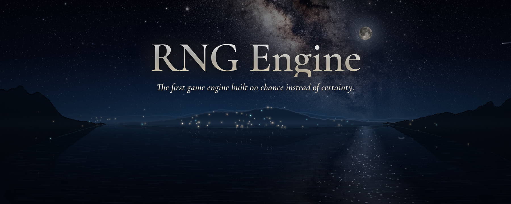

  

  <a href="https://charlesanthonyleone.github.io/rng-engine/"><b>Enter the bay &rarr; live site</b></a> &nbsp;&middot;&nbsp; <a href="THESIS.md"><b>Thesis</b></a>
  &nbsp;&middot;&nbsp; every scene is drawn from <code>crypto.getRandomValues</code>. No seed, no replay, never the same twice.

# RNG Engine

**The first game engine built on chance instead of certainty.**

Every engine you've ever used assumes determinism: same input, same output, forever. RNG Engine flips that. True randomness, with no seeds and no rewind, is the ground everything stands on. Nothing happens the same way twice, and that's the point.

## No seeds. No rewind.

*Plant the same kind of tree in the same kind of soil. You do not get the same apple back.*

Seeded randomness is a recording: the same seed plays back the same world forever. RNG Engine draws from a non-deterministic substrate instead. Every launch is a new universe.

## Every layer, inverted

Traditional engines treat randomness as a feature you call. Here it's the floor. Seven layers, built bottom-up, each inheriting chance from the one beneath it.

### 1. Substrate
Memory, math, and the clock itself are non-deterministic. There is no seed to find and no state to replay.

`xi[t] = entropy()`

### 2. Clock
Time doesn't tick; it rolls. Every moment branches into possible next moments and one becomes real. Time only moves forward.

`t[n+1] = pick(t'a, t'b, t'c)`

### 3. Simulation
Physics, AI, and anything that ticks forward. Outcomes fork. Throw the same rock twice and you get two histories.

`s[t+1] ~ K(s[t], a[t], xi[t])`

### 4. Representation
Rendering and audio. A texture loads differently each time, a sound never plays the same. What you see is a moment, not a copy.

`r[t] ~ P(view, s[t], xi[t])`

### 5. Structure
The scene graph reorganizes around what's alive. No two instances are identical by default; identity is earned, not assumed.

`G[t+1] = reorg(G[t], alive[t], xi[t])`

### 6. Behavior
Scripting and logic. Rules bend under probability. Code describes tendencies, and the world decides.

`a[t] ~ pi(intent, s[t], xi[t])`

### 7. Social
Networking, persistence, player-to-player and player-to-world connections. Shared reality, built from rolls nobody can predict or rewind.

`L[t+1] = append(L[t], e[t])`

## Pricing: price the verb, not the object

You pay to **generate**, never to own. Every creation is recorded into the universe, and the cost of generating it covers its base storage. No hoarding, no reselling.

| Creator | **$15/month**, with generation credits every month |
|---|---|
| Props & objects | Cheap |
| Characters & vehicles | Mid |
| Regions & rule changes | Expensive, and meant to be |

The cost is the filter. It keeps the universe from becoming a junk drawer of 18 trillion low-quality things, and it makes rare finds actually rare.

## The Vision

**Roblox meets No Man's Sky meets *imagine it*, with real physics.** User-built worlds, forking worlds, bodies with generated ligaments, and variety you can edit.

A randomly generated universe where anything someone can imagine can be real, with real physics. Spaceships. Flying surfboards. Whatever you can name, the world can hold it and it behaves like it belongs there.

Not infinite noise. Infinite *meaning*, because every thing in it cost someone something to bring into being.

Roblox and No Man's Sky are named for scale and feel only; no affiliation or endorsement.

## The Standard

The bar is simple: **ship one full game on it.**

Reverse-engineer Unreal Engine down to its single core assumption, determinism. Tear that out. Replace it with true RNG. Then rebuild every feature on top, layer by layer, until nothing is missing and nothing is the same.

The longer write-up, including the economic model, the rebuild phases and the risks, is in [THESIS.md](THESIS.md).

*Built by Charles Anthony Leone.*
