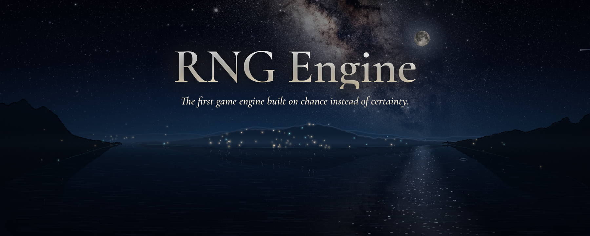

<p align="center"></p>

# RNG Engine — Thesis

**The first game engine built on chance instead of certainty.**

[Read the live thesis site](https://charlesanthonyleone.github.io/rng-engine/)

<p align="center"></p>

## Executive summary

**A universe is not a replay file.** Most worlds are generated once and then operated. RNG Engine asks a larger question: what if becoming were the operating principle?

The proposition is a persistent, shared universe in which creation is an irreversible event. Fresh entropy enters at the substrate. Physics constrains the possible; chance chooses the particular. AI turns an intention into a candidate, validation makes it admissible, and a durable record makes it part of the world.

The business model follows the same distinction: a subscription funds access and a bounded allowance of generation. Additional complexity consumes more credits. People pay for the act of bringing something into being—not for a scarce item to flip.

**The proof gate is one complete, playable, shippable game.** This document is the architectural and commercial thesis. The animated bay illustrates its aesthetic and non-repeatable composition; it is not evidence that the engine, asset pipeline, physics system, or business has been built or validated.

## The no-seed, no-rewind substrate

**The apple is an event.** Plant the same kind of tree in the same kind of soil. You do not get the same apple back.

An apple is not merely an item identifier. It has a particular shape, history, bruising, weight, and relation to the branch that grew it. Another apple can share its category without being its copy. Once picked, that event happened. Recording it does not mean that time can be rewound to unpick it.

That is the inversion. Categories and conservation laws remain coherent; exact sameness stops being the default. The engine samples admissible outcomes from fresh entropy, then commits the chosen outcome. A saved world preserves what happened. It does not preserve a recipe that can regenerate the same future.

```text
ξₜ ← fresh entropy
Sₜ₊₁ ∼ K( · | Sₜ, Aₜ, ξₜ )
Lₜ₊₁ = append(Lₜ, committed event)
```

S is world state, A is an action, K is a constrained transition kernel, and L is the durable event record. There is no public seed or reversible timeline. An event log records outcomes; it is not permission to undo them.

- **Random does not mean inconsistent.** “Non-deterministic math” means sampling within a mathematical model—not randomly changing arithmetic, corrupting memory, or letting a clock run backward. Memory safety, causal order, conservation constraints, and accounting must remain reliable. The literal universal substrate is a research ambition, not an implemented capability.
- **True entropy is an engineering requirement.** A production design would need an auditable physical-entropy source, conditioning, health checks, and a failure policy. Browser `crypto.getRandomValues` is a cryptographically strong randomness interface, not a guarantee of a direct physical RNG.
- **No rewind is a world rule.** Backups and disaster recovery are still necessary. Recovery must distinguish restoring a service from erasing player history. Debugging and audit tools may inspect recorded events without making the live universe replayable.

## The six inverted layers, with math

| Layer | Model | Constraint |
|---|---|---|
| 1. Substrate | `ξₜ ← Eₚₕᵧₛ ; τₜ₊₁ > τₜ` | Fresh entropy enters; the logical clock still preserves causal order. Entropy never substitutes for memory safety. |
| 2. Simulation | `sₜ₊₁ ∼ Kₚₕᵧₛ( · \| sₜ, aₜ, ξₜ )` | A transition is sampled within physical constraints. Random perturbation must not create free energy or impossible momentum. |
| 3. Representation | `rₜ ∼ P( · \| sₜ, viewpoint, ξₜ )` | Variation belongs inside a validated appearance envelope. Identity, collision boundaries, and accessibility cannot drift arbitrarily. |
| 4. Structure | `Gₜ₊₁ ∼ Kɢ( · \| Gₜ, event, ξₜ )` | A world graph evolves; referential integrity and durable identifiers survive the roll. Similar objects are not identical instances. |
| 5. Behavior | `aₜ ∼ π( · \| sₜ, intent, ξₜ )` | Scripts specify admissible tendencies. Hard rules, player consent, and safety limits remain non-negotiable constraints. |
| 6. Social | `eₜ ← authority ; Lₜ₊₁ = append(Lₜ, eₜ)` | The server commits one event and distributes it. Clients do not independently roll contradictory shared realities. |

## The $15/month pay-to-generate economy

People pay to generate. Price the verb, not the object. Small verbs (props and objects) are cheap; mid verbs cover characters and vehicles; large verbs—whole regions or rule changes—are expensive, and meant to be.

### Illustrative unit economics (assumptions, not results)

| Item | Per member / month |
|---|---:|
| Assumed subscription | $15.00 |
| Payment processing estimate (2.9% + $0.30) | −$0.74 |
| Included generation compute + validation | −$4.00 |
| Storage, bandwidth, moderation, support | −$1.25 |
| **Illustrative contribution** | **$9.01** |

**Break-even:** `subscribers = fixed monthly operating cost ÷ monthly contribution per member` → $300,000 ÷ $9.01 ≈ **33,300 paid members**. Assumes a $300,000 monthly fixed base for engineering, infrastructure, legal and safety operations, and administration. Taxes, refunds, chargebacks, content licensing, and financing costs are excluded and would raise the threshold.

### Illustrative three-year projection

| Scenario at year-end | Year 1 | Year 2 | Year 3 |
|---|---:|---:|---:|
| Conservative paid members | 8,000 | 22,000 | 45,000 |
| Conservative annualized subscription revenue | $1.44M | $3.96M | $8.10M |
| Conservative annualized contribution | $0.87M | $2.38M | $4.87M |
| Base paid members | 15,000 | 45,000 | 100,000 |
| Base annualized subscription revenue | $2.70M | $8.10M | $18.00M |
| Base annualized contribution | $1.62M | $4.87M | $10.81M |

**Labeled assumptions.** Revenue = paid members × $15 × 12, with no add-on credit sales, advertising, enterprise licensing, or price change. Contribution uses the $9.01 monthly member contribution, before fixed costs, taxes, and capital expenditure. The plan caps included generation so average compute stays near $4; heavy-use tiers would need separate pricing or throttling. **These are hypothetical scenarios only. No actual traction, fundraising, valuation, partner, or audited result is represented.**

## The vision: Roblox, Unreal, No Man's Sky

- **Roblox** proved that creators and players can share a vast platform. RNG Engine would invert the authored-object model: creation becomes an irreversible world event, not a repeatable asset upload.
- **Unreal** sets the professional bar for rendering, tooling, physics, and production. The proposal is to understand that stack deeply, identify where repeatability is assumed, and rebuild that layer around fresh entropy.
- **No Man's Sky** demonstrates the scale and wonder of procedural space. RNG Engine aims for a different property: discoveries that are not regenerated from a seed, and creations whose rarity comes from cost and history.

These are reference points for scale and ambition—not claims of partnership, compatibility, endorsement, equivalent capability, or market position.

## The phased Unreal rebuild plan

0. **Map the assumption.** Use permitted documentation, licensed source access, and clean-room analysis to map where repeatability is assumed: random streams, save systems, replication, physics stepping, tests, and asset identity. *Gate: dependency map, licensing review, and measurable invariants.*
1. **Build the entropy kernel.** Entropy service, constrained sampling layer, logical clock, and immutable event record with explicit failure behavior. *Gate: health tests, audit logs, and state integrity under failure.*
2. **Prove one bounded slice.** One small world and one complete loop: a player acts, physics samples an admissible outcome, the event commits, and every connected player sees the same result. *Gate: stable playtests on supported hardware and networks.*
3. **Add generation and economy.** Intent-to-asset generation, validation, moderation, storage, and credit metering without creating resale incentives. *Gate: cost per verb and quality thresholds meet the model.*
4. **Rebuild the feature stack.** Rendering, audio, AI, scripting, tooling, creator workflows, and persistence until the full game can be built without hand-waving. *Gate: feature-complete content pipeline and production QA.*
5. **Ship the proof.** Release one complete game, measure retention and cost in production, and expand toward a universe only after the bar is met. *Gate: public, supported, maintained release.*

## Risks and mitigations

1. **Engineering correctness.** Randomness can be mistaken for permission to corrupt memory, arithmetic, or timing. Keep integrity guarantees deterministic where safety requires them and randomize only admissible outcomes.
2. **Testing and debugging.** Non-repeatable worlds are harder to test. Use invariant tests, statistical acceptance tests, observability, and auditable event histories rather than relying only on exact replay.
3. **Multiplayer consistency.** Independent client rolls would split reality. An authoritative commit protocol, conflict handling, latency budgets, and anti-cheat controls are required.
4. **Generation cost and quality.** Generation, validation, moderation, and storage may exceed $15 per member. Metered verbs, usage caps, quality gates, and cost monitoring are mandatory.
5. **Legal, licensing, and IP.** Unreal is licensed technology. Reverse-engineering, engine changes, content generation, and distribution must follow applicable licenses and law; legal review belongs at the start, not after the build.
6. **Safety and trust.** Permanent generation can preserve harmful, infringing, or unwanted content. Moderation, takedown processes, privacy controls, and recovery policies must coexist with the no-rewind principle.

---

*Status: concept and architecture. Built by Charles Anthony Leone.*
